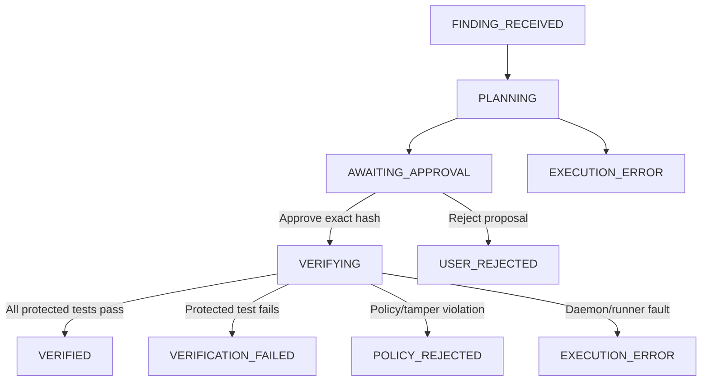

# Reproducible local demonstration

This demonstration uses the trusted document-access BOLA contract. It is a real uploaded ZIP and real verifier run; the supplied vulnerable source is deliberately controlled. Do not call it a repository-wide scan.

## Prerequisites and Environment Variables

The system requires Python 3.12, Node.js v18+, Docker Desktop (Linux container mode), and Ollama (if running local model inference).

Set configuration variables using `.env` or environment exports. **Never expose or commit secret values.**

| Variable Name | Purpose | Example / Default |
| :--- | :--- | :--- |
| `SENTINEL_OPERATOR_TOKEN` | Secret API authentication token for operators | `(ephemeral 32+ char hex)` |
| `SENTINEL_DB_PATH` | Path to the SQLite audit database | `local-audit/local-server.db` |
| `SENTINEL_PROJECT_ROOT` | Storage root for uploaded archives | `local-audit/projects` |
| `SENTINEL_SOURCE_ROOT` | Path to trusted lab source code | `verification/lab` |
| `SENTINEL_PROTECTED_TESTS_ROOT` | Path to tamper-proof test suites | `verification/protected_tests` |
| `SENTINEL_FRONTEND_ORIGIN` | Allowed CORS origin for frontend | `http://127.0.0.1:5173` |
| `SENTINEL_AGENT_CALLABLE` | Agent entry point | `agent.planner:propose_patch` |
| `SENTINEL_VERIFIER_CALLABLE` | Verifier entry point | `verification.adapter:verify_backend_patch` |
| `SENTINEL_PLANNER_TIMEOUT_SECONDS` | Max planner run duration (seconds) | `300` |
| `SENTINEL_INFERENCE_TIMEOUT` | Max LLM inference timeout (seconds) | `280` |
| `SENTINEL_MAX_TOKENS` | Max tokens generated by model | `350` |
| `SENTINEL_PROVIDER_RETRIES` | Max provider retry count | `0` |
| `VITE_API_BASE_URL` | Frontend API client base URL | `http://127.0.0.1:8000` |

---

## Service Startup Commands

### 1. Preflight Diagnostics
Check port availability and readiness dependencies without starting duplicate services:
```bash
# Windows PowerShell
$env:PYTHONPATH="."
python scripts/startup_check.py --backend-port 8000 --frontend-port 5173
```

### 2. Start Backend Service
```bash
# Option A: PowerShell helper script (generates ephemeral operator token automatically)
.\scripts\start_local_backend.ps1 -Port 8000 -CopyToken

# Option B: Manual uvicorn launch
$env:PYTHONPATH="."
python -m uvicorn backend.main:app --host 127.0.0.1 --port 8000
```

### 3. Start Frontend Development Server
```bash
cd frontend
npm run dev
# The frontend UI is available at http://127.0.0.1:5173
```

---

## Prepare Source Archive

From the project root:

```bash
python - <<'PY'
from pathlib import Path
from zipfile import ZipFile, ZIP_DEFLATED
out = Path('local-audit/demo-upload.zip')
out.parent.mkdir(exist_ok=True)
with ZipFile(out, 'w', ZIP_DEFLATED) as z:
    z.writestr('requirements.txt', 'fastapi==0.143.0\n')
    for name in ('__init__.py', 'access.py', 'sample_data.py'):
        z.write(Path('verification/lab/app') / name, 'app/' + name)
print(out.resolve())
PY
```

---

## End-to-End Workflow & Expected Lifecycle Transitions



1. **Intake**: Finding ingested via `POST /api/findings` or project upload → Job enters `FINDING_RECEIVED`.
2. **Planning**: AI agent analyzes source context and generates proposed patch → Job enters `PLANNING`. If inference fails or model is offline, transitions safely to `EXECUTION_ERROR`.
3. **Approval Binding**: Patch hash is calculated from canonical patch bytes (`sha256:...`). Job enters `AWAITING_APPROVAL`.
   - Modifying the patch invalidates existing approvals and requires fresh approval.
   - Operator reviews unified diff vs original source code, confirms hash integrity, and approves.
4. **Verification**: Operator requests verification (`POST /api/jobs/{id}/verify`).
   - Isolated Docker container executes protected test suite against the patched source.
   - Only the independent verifier determines the verdict:
     - All 8 protected tests pass → `VERIFIED`
     - Any protected test fails → `VERIFICATION_FAILED`
     - Modifying protected test files or policy violation → `POLICY_REJECTED`
     - Docker daemon unavailable or runtime fault → `EXECUTION_ERROR`
5. **Evidence Persistence**: Every run, test outcome, hash, and approval attestation is recorded in the SQLite audit ledger.

---

## Unified Security Case Page & Evidence Export

Navigate to `/investigation?jobId=<job_id>` in the browser dashboard:
1. **Finding & Source Details**: View vulnerability description, severity, source file path, and line numbers.
2. **Unified Diff & Original Source Toggle**: Tab between the proposed patch diff and the bounded original source context delivered via `GET /api/jobs/{job_id}/source`.
3. **Patch Hash Integrity**: Interactive SHA-256 badge with copy button, verifying exact patch hash binding.
4. **Approval Ledger**: View approver identity (`approved_by`), session kind, timestamp, and approved hash. Stale or modified patches display clear freshness warnings.
5. **Verification Outcomes**: Inspect the real individual test outcomes (e.g. `test_owner_can_read_document: PASSED`, `test_other_user_forbidden: PASSED`), duration, and suite profile ID.
6. **Download Evidence JSON**:
   - Click the **Download Evidence JSON** button in the Security Case page to export `sentinel-evidence-<job_id>.json`.
   - Alternatively, fetch directly via API:
     ```bash
     curl -H "X-Operator-Token: <token>" http://127.0.0.1:8000/api/jobs/<job_id>/evidence -o evidence.json
     ```

---

## Readiness & Dependency Diagnostics

Navigate to the **Settings** page (`/settings`) to view the real-time dependency status grid:
- **SQLite Database**: Verifies connectivity and table schema integrity.
- **Ollama HTTP Service**: Probes `http://127.0.0.1:11434/api/tags`.
- **Target Model (`qwen2.5-coder:7b`)**: Confirms model weights are pulled.
- **Docker Daemon**: Checks communication with the local Docker engine socket.
- **Verifier Image (`sentinel-verification-lab:latest`)**: Ensures lab image is built.
- **System Patch Utility**: Verifies `patch.exe` is available in PATH.
- **Configuration Root Paths**: Checks source root and protected test suite paths.

Each unavailable dependency displays specific, actionable remediation commands with zero exposed secrets.

---

## Known Limitations & Security Boundaries

1. **Docker Daemon Dependency**: Verification isolation requires a running Docker engine. If Docker Desktop is stopped, the verifier transitions to `EXECUTION_ERROR` with a descriptive message rather than fabricating passing results.
2. **No Host Execution**: Untrusted model-generated patches are never applied or executed directly on the host machine.
3. **Strict Hash Binding**: Verification strictly fails if the patch diff has been tampered with or if the approved hash does not match the canonical SHA-256 hash of the patch bytes.
4. **Isolated Test Protections**: Protected tests located in `verification/protected_tests` cannot be modified or bypassed by the agent patch; any patch attempting to alter test files is rejected with `POLICY_REJECTED`.

---

## Automated Test Verification

Run all test suites without Docker:
```bash
# Backend unit, integration, and security case tests (104 passed)
pytest backend/tests -m "not docker"

# Persona and agent planner tests (54 passed)
pytest agent/tests -m "not docker"

# Frontend TypeScript check and production build
cd frontend
npm run typecheck
npm run build
```
