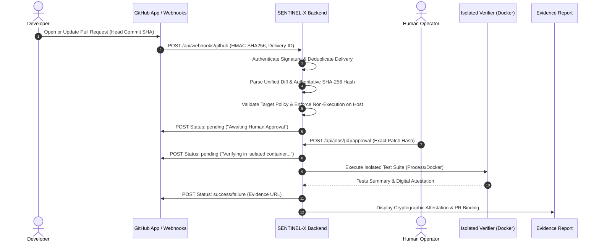

# SENTINEL-X — GitHub Pull Request Verification Integration

## 1. Architecture & Design Principles

SENTINEL-X integrates natively with GitHub Pull Requests without introducing a parallel verification pipeline or separate runner architecture. All PR candidate diffs pass through the authoritative policy engine, require explicit cryptographic hash approval, execute exclusively inside isolated containers (Docker / sandbox), and publish immutable verification verdicts with direct links to the Ed25519 digitally signed evidence report.

---

## 2. Least-Privilege GitHub App Permissions

In accordance with Section A of the specification, SENTINEL-X strictly adheres to the principle of least privilege. It does **not** request organization-wide write access or repository administration permissions.

### Required Repository Permissions
| Permission | Access | Purpose |
| :--- | :--- | :--- |
| **Pull requests** | `Read-only` | Receive webhook events (`opened`, `synchronize`, `closed`), inspect base/head commit SHAs, PR metadata. |
| **Repository contents** | `Read-only` | Bounded retrieval of candidate unified diffs (`settings.max_patch_bytes = 32KB`). |
| **Commit statuses** | `Read & write` | Publish verification states (`pending`, `success`, `failure`, `error`) on exact commit SHAs. |

### Organization & Account Permissions
- **All Organization Permissions**: `None`
- **All Account Permissions**: `None`

---

## 3. Security and Patch Integrity Invariants

1. **Exact Commit SHA Binding**:
   - Every verification request is strictly bound to `(repo_full_name, pr_number, base_sha, head_sha)`.
   - Stored in SQLite table `github_pr_bindings`.
2. **Zero Host Execution**:
   - Untrusted pull-request code is **never** executed, imported, or evaluated on the host system.
   - Host logic is restricted to syntactic unified diff parsing, marker inspection, and cryptographic hashing.
   - All code execution occurs inside disposable isolated execution environments.
3. **Explicit Human Approval Gating**:
   - A passing test result does **not** automatically grant human approval.
   - All candidate patches from pull requests enter `AWAITING_APPROVAL`.
   - The exact patch hash must be explicitly approved by an authorized operator before execution commences.
4. **Stale Commit Supersession**:
   - When a PR receives a new commit (`action: synchronize`), any prior running or completed verification jobs for previous commit SHAs are marked `is_stale = 1` and `commit_status = 'superseded'`.
   - The previous commit receives an updated status indicating it was superseded.
   - Verification is re-run from scratch for the new commit; previous verdicts are never reused.
5. **Delivery Idempotency**:
   - Every delivery is tracked in `github_deliveries` using the `X-GitHub-Delivery` GUID.
   - Redeliveries due to network timeouts or retries are safely ignored (`duplicate_ignored`) without creating duplicate verification jobs.
6. **HMAC-SHA256 Webhook Authentication**:
   - Webhook payloads must be signed with `X-Hub-Signature-256`.
   - Constant-time comparison (`hmac.compare_digest`) prevents timing side-channels.
   - Unauthenticated or spoofed requests are rejected immediately with HTTP 401.

---

## 4. Configuration Reference

| Environment Variable | Default | Purpose |
| :--- | :--- | :--- |
| `SENTINEL_GITHUB_WEBHOOK_SECRET` | *(empty)* | Secret configured in GitHub App / Webhook settings for HMAC verification. |
| `SENTINEL_GITHUB_TOKEN` | *(empty)* | Installation access token or bot token used to publish commit statuses. |
| `SENTINEL_GITHUB_ALLOWED_REPOSITORIES` | `*` (demo/dev) | Comma-separated whitelist of allowed repositories (e.g. `sentinel-sec/demo-target`). |
| `SENTINEL_BASE_URL` | `http://localhost:5173` | Base URL used to construct immutable evidence links in commit statuses. |

---

## 5. Test Suite Verification Report

Automated tests in `backend/tests/test_github_pr_integration.py` were executed against disposable non-production fixtures. All 13 tests passed:

1. `test_webhook_signature_verification`: Verifies valid signatures pass and tampered payloads or wrong secrets are rejected.
2. `test_repository_authorization_policy`: Verifies repository whitelist enforcement and syntax validation.
3. `test_webhook_rejects_unauthorized_signature`: Verifies HTTP 401 `WEBHOOK_SIGNATURE_INVALID` on bad signature.
4. `test_webhook_delivery_idempotency`: Verifies duplicate deliveries (`X-GitHub-Delivery`) return HTTP 200 without creating redundant jobs.
5. `test_webhook_rejects_unauthorized_repository`: Verifies HTTP 403 `UNAUTHORIZED_REPOSITORY` for unapproved repos.
6. `test_pull_request_opened_workflow`: Verifies PR intake creates a real SENTINEL-X job, binds base/head commits, and posts `pending` commit status.
7. `test_pull_request_synchronize_supersedes_stale_commits`: Verifies pushing a new commit supersedes older jobs and posts a superseded status to the old commit.
8. `test_end_to_end_verification_and_result_publication`: Full workflow from webhook -> approval -> isolated verifier -> published `success` status -> verified evidence report.
9. `test_verification_failure_publishes_failure_status`: Verifies that failing verification runs publish `failure` commit status with defect details.
10. `test_pull_request_closed_marks_bindings_closed`: Verifies PR closed event updates bindings to closed.
11. `test_get_pr_binding_endpoint`: Verifies `GET /api/github/bindings/{job_id}` metadata retrieval.
12. `test_rate_limit_and_network_error_resilience`: Verifies handling of GitHub API rate limits (HTTP 429/403 with `X-RateLimit-Remaining: 0`) and reset times.
13. `test_credential_isolation_and_no_leakage`: Verifies credentials are never returned in API payloads or passed to verification runners.

Full repository test status: **283 PASSED**, 2 skipped, 12 deselected, 0 failures.
